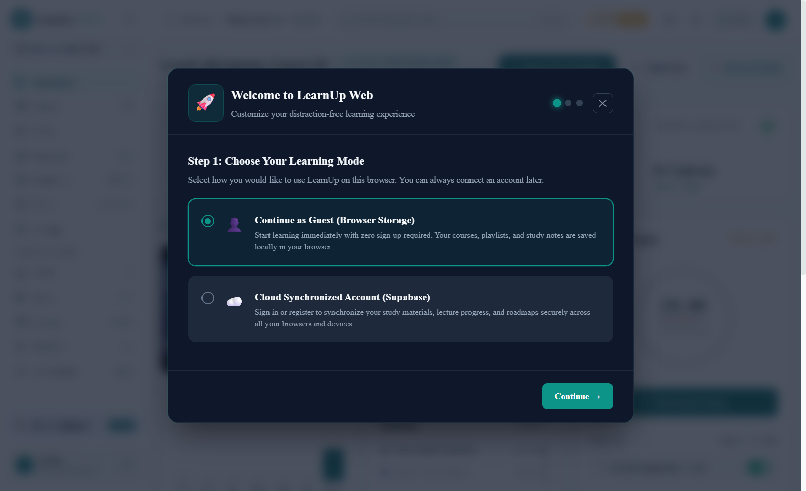
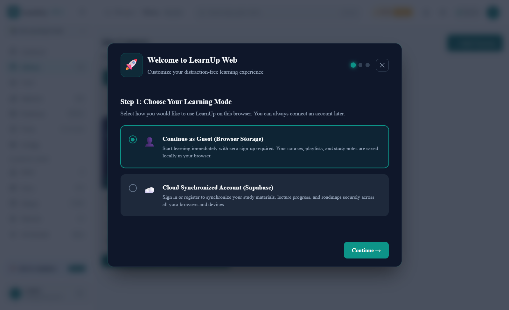
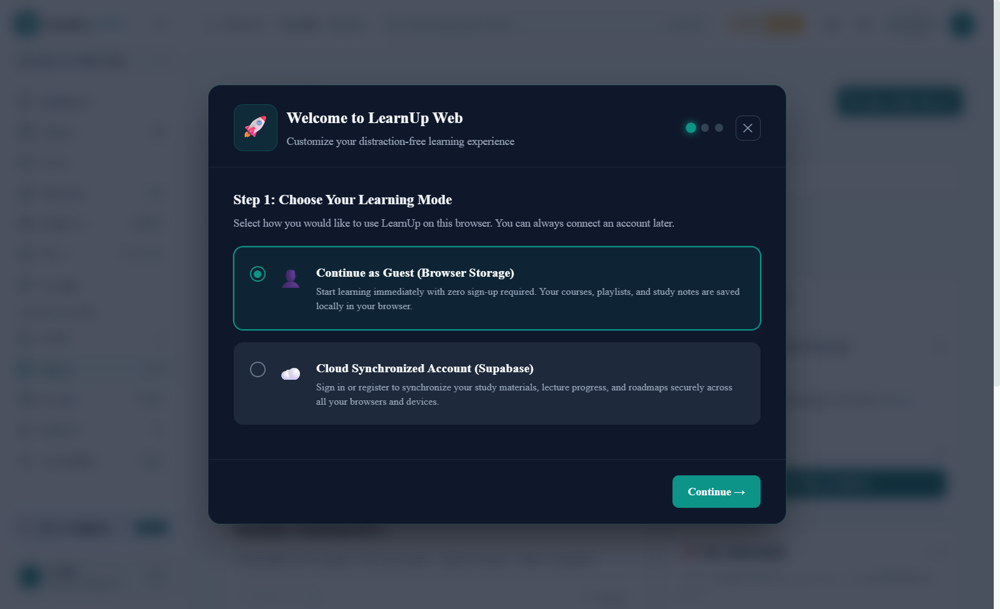
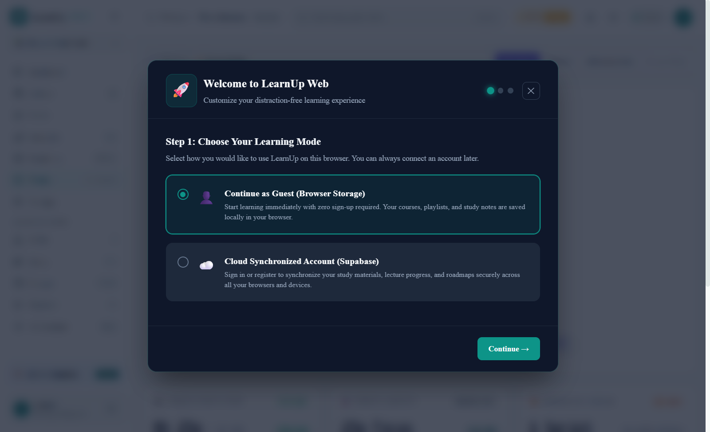
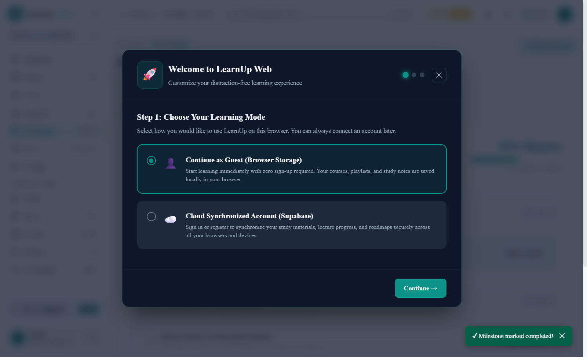
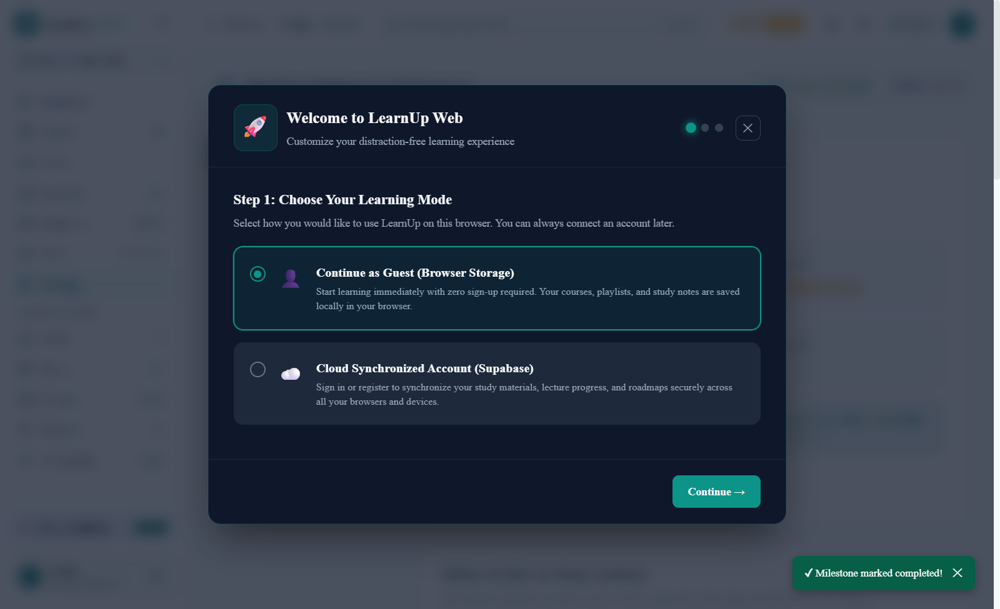

# LearnUp Desktop 🎓

> **A native, offline-first learning companion for Windows.**  
> Learn on your terms with local-first structured courses, active recall note-taking, Pomodoro focus sanctuary, roadmaps, and isolated local SQLite persistence.

[](https://github.com/Kadhiravan-K/LearnUp--Desktop/releases)
[](LICENSE)
[-blueviolet?style=flat-square)](https://github.com/Kadhiravan-K/LearnUp--Desktop/releases/latest)
[](tests)

---

## ⚡ Direct Download

Download the ready-to-run Windows installer directly from our official GitHub release:

👉 **[Download LearnUp Desktop for Windows (.exe)](https://github.com/Kadhiravan-K/LearnUp--Desktop/releases/latest)**

*Requires 64-bit Windows 10 or 11. No developer tools, Node.js, or command prompt required.*

---

## 📸 Screenshots

| 📊 Clean Learning Dashboard | 📚 Course & Lecture Library |
|:---:|:---:|
|  |  |

| ✍️ Active Recall Notes Workspace | ⏱️ Focus Sanctuary (Pomodoro) |
|:---:|:---:|
|  |  |

| 🗺️ Learning Roadmaps & Milestones | ⚙️ Complete Settings & Preferences |
|:---:|:---:|
|  |  |

---

## ✨ Features

- **📴 True Offline-First Architecture**  
  Every lecture, note, bookmark, roadmap milestone, and focus session is stored locally in an isolated SQLite database. The app launches and functions completely without an active internet connection.

- **🎥 YouTube Learning Experience**  
  Curate lectures, resume playback exactly where you left off, and take timestamped bookmarks synchronized with lecture timestamps.

- **📝 Markdown Notes & Search**  
  Rich markdown editor with auto-save, tag indexing, fast full-text filtering, and preview rendering.

- **⏱️ Focus Sanctuary**  
  Built-in Pomodoro timer with configurable focus cycles, short/long breaks, audio feedback, and study streak analytics.

- **🗺️ Interactive Skill Roadmaps**  
  Visual milestone tracking, progress visualization, and structured learning tracks.

- **👥 Multi-Profile Isolation**  
  Switch instantly between Guest profiles and personalized user workspaces without data cross-contamination.

- **🔄 Resilient Cloud Sync Foundation**  
  Equipped with an idempotent mutation journal, collision resolution, and opt-in Supabase transport. Guest data is never uploaded automatically without explicit user consent.

- **🎨 Design Parity with LearnUp Web**  
  Crafted using the same modern dark design language, responsive panels, dialog modals, and micro-interactions as the web application.

---

## 🚀 Installation Guide for Windows Users

Installing LearnUp Desktop takes less than a minute:

1. **Download the Setup Executable**:  
   Visit the **[Releases Page](https://github.com/Kadhiravan-K/LearnUp--Desktop/releases/latest)** and download `LearnUp-Desktop_0.2.0-beta.1_x64-setup.exe` (or the latest release setup `.exe`).

2. **Launch Setup**:  
   Double-click the downloaded setup file.

3. **Windows Defender SmartScreen**:  
   Because LearnUp Desktop is a newly published community open-source release without an expensive enterprise certificate, Windows may show:  
   > *"Windows protected your PC"*  
   - Click **More info**  
   - Click **Run anyway**  
   *(The source code is 100% open-source and auditable right here on GitHub).*

4. **Complete Setup**:  
   Follow the standard setup wizard. The installer sets up:
   - Application files in `%LOCALAPPDATA%\Programs\LearnUp Desktop`
   - Start Menu entry
   - Desktop shortcut (optional)
   - Proper Windows Add/Remove Programs uninstall registration

5. **Start Learning**:  
   Open **LearnUp Desktop** from your Desktop or Start Menu!

---

## 🛡️ Upgrades & Data Preservation

Upgrading to future releases is seamless:
- User data, lecture bookmarks, notes, and profiles are safely stored in your Windows user directory (`%APPDATA%\com.learnup.desktop\learnup.db`).
- Installing a newer version or re-running the installer updates the application binary while **strictly preserving all existing SQLite learning databases**.

---

## 🛠️ Architecture & Tech Stack

LearnUp Desktop combines native performance with modern web UI technologies:

| Layer | Technology | Details |
|---|---|---|
| **OS Shell** | [Tauri v2](https://v2.tauri.app/) | High-performance, lightweight native Windows shell (~15MB installer) |
| **Backend** | Rust 2021 + Rusqlite | Native SQLite persistence with Write-Ahead Logging (WAL) and single-instance locks |
| **Frontend** | React 18 + TypeScript 5 | Strict types, modular views, accessible UI controls |
| **Bundler** | Vite 5 | Optimized ES module packaging with tree-shaking |
| **Styling** | Tailwind CSS + CSS Modules | Dark theme palette, custom scrollbars, cohesive design tokens |
| **Icons** | Lucide React | High-clarity iconography |
| **Testing** | Vitest + Happy DOM | Comprehensive unit and integration test suite (84 automated tests) |

---

## 💻 Building from Source

If you wish to compile LearnUp Desktop locally:

### Prerequisites
- [Node.js](https://nodejs.org/) (v18 or higher)
- [Rust & Cargo](https://rustup.rs/) (stable channel, 64-bit MSVC)
- [Visual Studio C++ Build Tools](https://visualstudio.microsoft.com/visual-cpp-build-tools/)

### Steps
```bash
# Clone the repository
git clone https://github.com/Kadhiravan-K/LearnUp--Desktop.git
cd LearnUp--Desktop

# Install frontend dependencies
npm install

# Run automated tests and type checks
npm run typecheck
npm test

# Launch in Tauri development mode
npm run tauri dev

# Build the production Windows NSIS installer
npm run tauri -- build --bundles nsis
```
The output installer `.exe` will be located in:  
`src-tauri/target/release/bundle/nsis/`

---

## ⚠️ Beta Disclaimer & Feedback

LearnUp Desktop `v0.2.0-beta.1` is an active public beta. We are actively refining features, cloud synchronization, and offline capabilities.

- If you encounter any bugs, unexpected behavior, or display issues:  
  👉 **[Open an Issue on GitHub](https://github.com/Kadhiravan-K/LearnUp--Desktop/issues)**
- Feature suggestions and contributions are always welcome!

---

## 📄 License

This project is licensed under the [MIT License](LICENSE).
