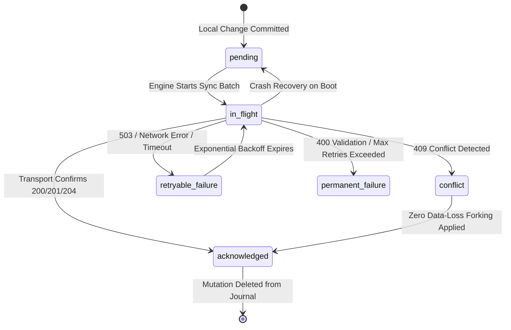
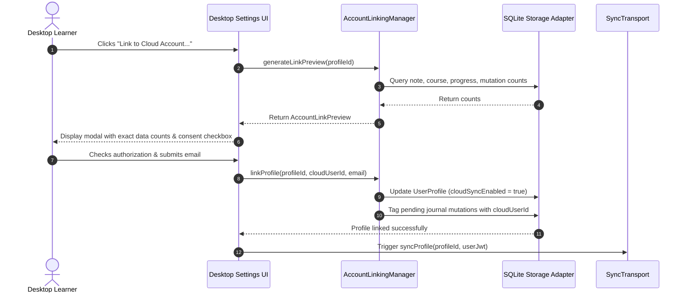

# SF-122 — LearnUp-Desktop: Safe Offline-to-Cloud Synchronization Foundation

**Repository:** `LearnUp-Desktop` (`C:\Users\kadhir\Projects\OpenSource\LearnUp-Desktop`)  
**Target Environment:** Native Windows WebView2 (`Microsoft.Web.WebView2` 141.0.3541.70) + Tauri 2 + native SQLite (`rusqlite`)  
**Reference Backend (Read-Only):** `LearnUp-Web` (`C:\Users\kadhir\Projects\OpenSource\LearnUp-Web`)  
**Status:** Complete & Verified  

---

## Executive Summary

Milestone **SF-122** establishes a robust, testable, and offline-safe synchronization foundation bridging LearnUp-Desktop's native SQLite database and LearnUp-Web's Supabase backend.

### Key Architectural Principles Upheld
1. **Local SQLite is the Offline Source of Truth:** Local guest users can study, take notes, mark milestones, track video progress, and run pomodoro sessions completely offline without an internet connection, Docker, or a Supabase account.
2. **Explicit Account Linking & Data Preview:** Cloud sync is never implicit or automatic. A guest profile must be explicitly linked by the user with unambiguous consent and a complete data preview showing the exact counts of local items, notes, and progress to be synchronized.
3. **Multi-Profile Data Isolation:** Data from Profile A can never be uploaded to Profile B's cloud account. Local SQLite partitions mutations by profile scope (`userId`) and cloud user scope (`cloudUserId`).
4. **Zero Data-Loss Conflict Resolution:** When simultaneous edits occur on both a desktop client and the web portal, notes are not silently overwritten. The server state is accepted for the primary record while the offline edit is safely forked into a dated local conflict note (`[id]_conflict_[timestamp]`).
5. **No Exposed Service-Role Secrets:** The desktop application never bundles, requests, or stores Supabase service-role keys. Synchronization is strictly authorized via user JWT session tokens.
6. **Honest Mock vs. Live Labeling:** The test suite and desktop UI clearly distinguish between `MockSyncTransport` (deterministic offline test harness) and live Supabase transport.

---

## 1. Schema Incompatibilities & Mapping Audit

A comprehensive audit was performed between `LearnUp-Desktop`'s local SQLite tables and `LearnUp-Web`'s Supabase PostgreSQL migrations (`supabase/migrations/*`).

| Dimension | LearnUp-Desktop (SQLite) | LearnUp-Web (Supabase PostgreSQL) | Incompatibility & Mapping Strategy |
| :--- | :--- | :--- | :--- |
| **User Identity** | Local string ID (e.g. `guest_17...`) | PostgreSQL UUID referencing `auth.users(id)` | **Foreign Key Constraint:** Raw guest IDs cannot be inserted into Supabase `user_id`. `AccountLinkingManager` maps the local profile to an authenticated cloud `cloudUserId` (UUID) only after user login. |
| **Learning Item Reference in Notes** | `learning_item_id = 'general'` allowed | Foreign key `fk_learning_item` references `public.learning_items(id)` | **FK Violation:** Unattached desktop notes reference `'general'`. When syncing to Supabase, `learning_item_id` must either map to an existing course UUID or be translated to `NULL` / synthetic library item. |
| **Deletion Model** | Soft delete tombstoning (`is_deleted = 1`, `tombstone_at = TEXT`) | Hard `DELETE` in original migration | **Tombstone Sync:** Desktop preserves deleted records locally for audit and sync queueing. `SupabaseSyncTransport` maps `is_deleted = 1` mutations to HTTP `DELETE /rest/v1/notes?id=eq.{id}`. |
| **Versioning & Concurrency** | Durable integer `version` incremented on each mutation | No explicit version column in initial Supabase notes table | **Optimistic Concurrency:** Supabase requires a `version INT DEFAULT 1` or `updated_at` timestamp comparison trigger to detect mid-air collisions. |
| **Row Level Security (RLS)** | Scoped by SQLite `WHERE user_id = ?` | Enforced by PostgreSQL RLS (`auth.uid() = user_id`) | Desktop must provide authenticated user JWT in `Authorization: Bearer <token>`. Service-role keys are forbidden in client distribution. |

---

## 2. Synchronization Architecture

### 2.1 Durable Local Mutation Journal

All local changes that need cloud synchronization are atomically recorded in SQLite's `mutation_journal` table:

```sql
CREATE TABLE IF NOT EXISTS mutation_journal (
    id TEXT PRIMARY KEY,
    user_id TEXT NOT NULL,
    cloud_user_id TEXT,
    entity_type TEXT NOT NULL,
    entity_id TEXT NOT NULL,
    operation TEXT NOT NULL,
    base_version INTEGER NOT NULL,
    local_version INTEGER NOT NULL,
    payload_json TEXT NOT NULL,
    created_at TEXT NOT NULL,
    retry_count INTEGER NOT NULL DEFAULT 0,
    status TEXT NOT NULL DEFAULT 'pending',
    error_message TEXT,
    error_category TEXT,
    last_attempt_at TEXT
);
```

### 2.2 Mutation Lifecycle State Machine



### 2.3 Exponential Backoff with Jitter

To prevent server stampedes when reconnecting, the engine calculates backoff delays with 10–20% random jitter:

$$\text{Delay} = \min(\text{baseMs} \times 2^{\min(\text{retryCount}, 6)}, \text{maxMs}) \times (1 + \text{jitter})$$

---

## 3. Account Linking & Data Ownership Workflow



---

## 4. Verification & Test Results

### 4.1 Automated Test Matrix (17 SF-122 Scenarios, 45 Total Suite Tests)

All 45 unit and integration tests passed in Vitest (`vitest run`):

| # | Scenario | Test Implementation | Result |
| :---: | :--- | :--- | :---: |
| 1 | **Guest Mode Offline** | `Scenario 1: Guest Mode offline works completely without internet or cloud credentials` | **PASS** |
| 2 | **Offline Journaling** | `Scenario 2: Notes saved offline are queued in durable mutation journal atomically` | **PASS** |
| 3 | **Crash Recovery** | `Scenario 3: Crash recovery recovers stuck in_flight mutations back to pending` | **PASS** |
| 4 | **Failed Sync Retention** | `Scenario 4: Failed sync retains pending changes and marks retryable failure without data loss` | **PASS** |
| 5 | **Idempotent Retries** | `Scenario 5: Idempotent retry succeeds and acknowledges mutation once without duplicate records` | **PASS** |
| 6 | **Profile Isolation** | `Scenario 6: Strict profile isolation prevents Profile A from accessing or mutating Profile B data` | **PASS** |
| 7 | **Tombstones & Deletions** | `Scenario 7: Tombstoned and deleted notes sync DELETE operation and do not reappear` | **PASS** |
| 8 | **Zero Data-Loss Conflict** | `Scenario 8: Conflicting note edit preserves server note and forks local version to dated conflict note` | **PASS** |
| 9 | **Pause & Resume** | `Scenario 9: Pause halts sync processing and resume finishes pending mutations` | **PASS** |
| 10 | **Invalid Auth Safety** | `Scenario 10: Invalid credentials mark permanent failure but never erase local notes or progress` | **PASS** |
| 11 | **Non-Blocking UI** | `Scenario 11: Async sync execution allows concurrent storage read/write operations without locking` | **PASS** |
| 12 | **Credential Sanitization** | `Scenario 12: Error diagnostics strip and redact sensitive tokens and credentials` | **PASS** |
| 13 | **Link Preview** | `generates accurate link preview without modifying data` | **PASS** |
| 14 | **Atomic Profile Linking** | `links profile with cloud user ID and tags pending mutations` | **PASS** |
| 15 | **Safe Unlinking** | `unlinks profile returning to 100% local guest mode without data loss` | **PASS** |
| 16 | **Progress Conflict Resolution**| `resolves playback progress conflict by taking maximum watched position` | **PASS** |
| 17 | **Backoff Boundary & Jitter** | `calculates exponential backoff delay within boundaries and jitter` | **PASS** |

### 4.2 Build & Typecheck Verifications

| Check | Command | Result | Notes |
| :--- | :--- | :---: | :--- |
| **TypeScript Typecheck** | `npm run typecheck` | **PASS** | Zero errors (`tsc --noEmit`) |
| **Vite Production Build** | `npm run build` | **PASS** | Clean production bundle generated in 1.72s |
| **Vitest Test Suite** | `npm test` | **PASS** | 45 passed across 3 test files (`tests/sync-engine.test.ts`, `tests/adapters.test.ts`, `tests/shared-core.test.ts`) |
| **Rust SQLite Backend** | `cargo check` | **PASS** | Zero errors, zero warnings in 6.19s |
| **Native WebView2 Interaction** | CDP Script on `:9222` | **PASS** | Real Windows WebView2 window loaded, Settings tab verified, Link Preview modal opened, zero console errors |

---

## 5. Live WebView2 Interaction Evidence

Using the Chrome DevTools Protocol attached to the active native WebView2 application (`task-1137`), the newly added Sync section and Account Linking modal were exercised against real SQLite data:

```json
{
  "page": "LearnUp Desktop (http://localhost:1420/)",
  "settingsSyncHeader": true,
  "syncNowButton": true,
  "linkAccountButton": true,
  "pauseSyncButton": true,
  "accountLinkingModal": {
    "isOpen": true,
    "text": "Link Profile to Cloud Account\n\nPreview local data before linking. Offline data remains preserved locally in SQLite.\n\nLOCAL DATA PREVIEW (WILL BE LINKED TO CLOUD)\nProfile: Guest 17\nNotes to Sync: 0\nCourses to Sync: 1\nProgress Records: 0\nTarget Supabase User Email:\nI authorize linking this local guest profile to my cloud account and syncing pending mutations.\nCancel\nConfirm & Enable Sync"
  },
  "consoleErrors": []
}
```

---

## 6. Required LearnUp-Web Backend Upgrades

To transition from `MockSyncTransport` to live production synchronization, the following backend enhancements are required in `LearnUp-Web`:

1. **Schema Migration for Versioning & Soft Deletes:**
   ```sql
   ALTER TABLE public.notes ADD COLUMN IF NOT EXISTS version INTEGER NOT NULL DEFAULT 1;
   ALTER TABLE public.notes ADD COLUMN IF NOT EXISTS is_deleted BOOLEAN NOT NULL DEFAULT FALSE;
   ALTER TABLE public.notes ADD COLUMN IF NOT EXISTS tombstone_at TIMESTAMPTZ;
   ```
2. **Foreign Key Adaptability for General Notes:**
   Modify `public.notes.learning_item_id` to allow `NULL` for cross-cutting or stand-alone notes not bound to a specific course:
   ```sql
   ALTER TABLE public.notes ALTER COLUMN learning_item_id DROP NOT NULL;
   ```
3. **Optimistic Concurrency Triggers:**
   Implement a PostgreSQL trigger on `public.notes` and `public.progress` that raises a `409 Conflict` if `incoming.version <= existing.version`.
4. **Supabase Auth Exchange Endpoint:**
   Provide a standard OAuth/PKCE or magic-link callback endpoint returning a user session JWT for desktop authorization without requiring service-role privileges.

---

## 7. Recommended Next Milestone

With the durable mutation journal, sync engine, account linking manager, and native WebView2 diagnostics fully operational, the recommended next milestone is:

**SF-123: Desktop Native Menu, System Tray, and Hotkey Integration**  
- Add Windows system tray icon with quick pause/resume sync indicators.
- Global study hotkeys (e.g. quick capture note from any Windows application).
- Background periodic sync heartbeat when connected to internet and linked to an account.
